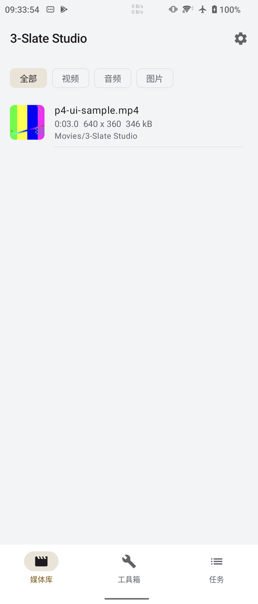
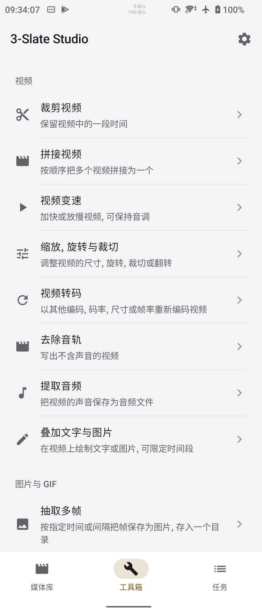
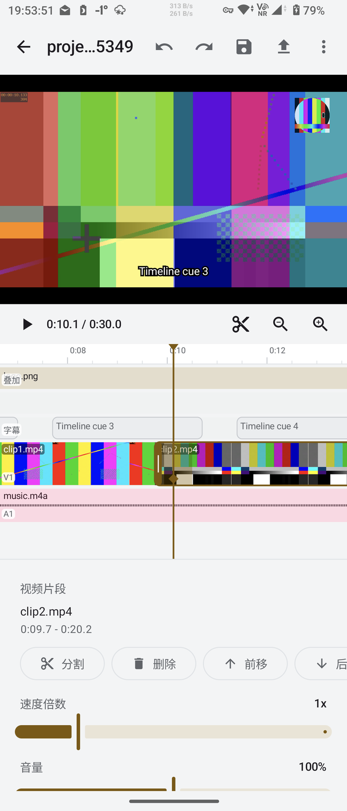
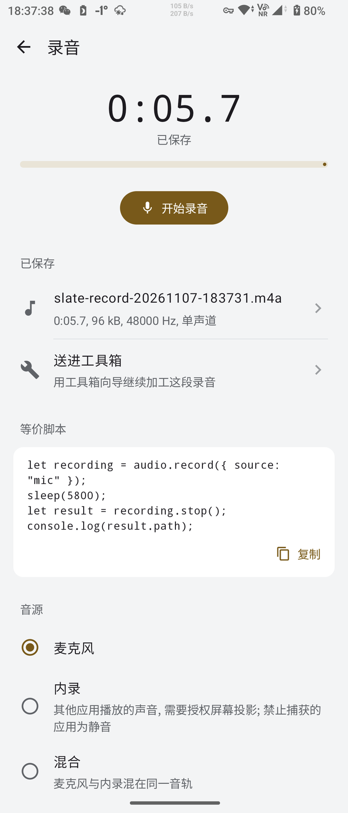

<!--suppress HtmlDeprecatedAttribute, HttpUrlsUsage -->

<div align="center">
  <p>
    <picture>
      <source srcset="https://github.com/SuperMonster003/AutoJs6-Plugin-Three-Slate-Studio/blob/master/app/src/main/res/mipmap-night/ic_launcher.png?raw=true" media="(prefers-color-scheme: dark)" />
      
    </picture>
  </p>

  <p>Procesamiento de vídeo y audio, edición multipista con línea de tiempo, transiciones y subtítulos, con código de script generado desde las pantallas</p>

  <p>
    <a href="https://github.com/SuperMonster003/AutoJs6-Plugin-Three-Slate-Studio/releases"></a>
    <a href="https://github.com/SuperMonster003/AutoJs6-Plugin-Three-Slate-Studio/issues"></a>
    <a href="https://github.com/SuperMonster003/AutoJs6-Plugin-Three-Slate-Studio/blob/master/LICENSE"></a>
  </p>
</div>

******

### Idiomas (Languages)

******

El README.md actual admite los siguientes idiomas:

- [简体中文 [zh-Hans]](https://github.com/SuperMonster003/AutoJs6-Plugin-Three-Slate-Studio/blob/master/.readme/README-zh-Hans.md)
- [繁體中文 (香港) [zh-Hant-HK]](https://github.com/SuperMonster003/AutoJs6-Plugin-Three-Slate-Studio/blob/master/.readme/README-zh-Hant-HK.md)
- [繁體中文 (台灣) [zh-Hant-TW]](https://github.com/SuperMonster003/AutoJs6-Plugin-Three-Slate-Studio/blob/master/.readme/README-zh-Hant-TW.md)
- [English [en]](https://github.com/SuperMonster003/AutoJs6-Plugin-Three-Slate-Studio/blob/master/.readme/README-en.md)
- [Français [fr]](https://github.com/SuperMonster003/AutoJs6-Plugin-Three-Slate-Studio/blob/master/.readme/README-fr.md)
- Español [es] # actual
- [日本語 [ja]](https://github.com/SuperMonster003/AutoJs6-Plugin-Three-Slate-Studio/blob/master/.readme/README-ja.md)
- [한국어 [ko]](https://github.com/SuperMonster003/AutoJs6-Plugin-Three-Slate-Studio/blob/master/.readme/README-ko.md)
- [Русский [ru]](https://github.com/SuperMonster003/AutoJs6-Plugin-Three-Slate-Studio/blob/master/.readme/README-ru.md)
- [العربية [ar]](https://github.com/SuperMonster003/AutoJs6-Plugin-Three-Slate-Studio/blob/master/.readme/README-ar.md)

******

### Introducción

******

3-Slate Studio es el complemento de vídeo y audio de AutoJs6 y también una aplicación de edición que funciona sin AutoJs6. Recorta, une, acelera, escala, gira, encuadra y marca con agua los vídeos, extrae fotogramas, crea GIF y transcodifica; recorta, une, mezcla, aplica fundidos y convierte el audio; y su editor de línea de tiempo multipista combina clips con transiciones, superposiciones y subtítulos.

El procesamiento se ejecuta en el complemento con Jetpack Media3 Transformer y los códecs por hardware del dispositivo, de modo que el host AutoJs6 sigue siendo ligero. Los scripts de AutoJs6 procesan medios con los módulos globales `video` y `audio`; la grabación de pantalla (`video.record`) y la grabación de audio (`audio.record`) están integradas en AutoJs6 y funcionan sin el complemento. Cada pantalla de herramienta del complemento muestra el código de script equivalente, que se puede copiar o abrir como un script nuevo en AutoJs6.

> La versión 1.0.0 es la primera versión publicada. Procesar medios en scripts requiere AutoJs6 6.8.1 (compilación interna 6641) o posterior; las pantallas del complemento, el editor de línea de tiempo y la grabadora de Studio no dependen de AutoJs6.

******

### Funciones Destacadas

******

- Edición de vídeo: recorte por tiempo, unión, cambio de velocidad (de 0.25x a 8x), escalado, giro, encuadre y volteo, marcas de agua de texto o imagen, extracción o eliminación de la pista de audio y transcodificación (H.264 por defecto, H.265 si el dispositivo tiene un codificador H.265).
- Fotogramas y GIF: fotogramas sueltos, secuencias de fotogramas y miniaturas como archivos PNG o JPG u objetos `Image`, y animaciones GIF con el codificador integrado.
- Audio: recorte, unión, mezcla de varias entradas (reducida automáticamente cuando la suma saturaría), ajuste del volumen con fundido de entrada y de salida, cambio de velocidad y conversión a M4A, WAV, FLAC u OGG (OGG requiere Android 10 o posterior).
- Editor de línea de tiempo multipista: pistas de vídeo, audio, superposición y subtítulos, 7 transiciones (corte, fundido, disolución, deslizamiento, barrido, zoom, desenfoque), vista previa en directo, deshacer y rehacer, y proyectos guardados como `.slate.json`; los subtítulos admiten importación y exportación de SRT y un subconjunto básico de ASS, incrustados en la imagen al exportar.
- Caja de herramientas: un asistente para cada función de procesamiento, con formularios que muestran los valores por defecto y los rangos; las tareas se ejecutan en una cola que muestra el progreso y el motivo de los fallos, y las tareas largas mantienen una notificación en primer plano.
- Generación de código: cada asistente, la exportación de la línea de tiempo y la grabadora producen el script `video.*` / `audio.*` equivalente, listo para copiar o abrir como un script nuevo en AutoJs6.
- Grabadora de Studio: graba el micrófono, el audio interno del dispositivo (Android 10 o posterior) o ambos desde las pantallas del complemento en M4A o WAV, con pausa y una grabación que continúa con la pantalla apagada.
- Biblioteca FFmpeg (prevista para la 1.1.0): una descarga opcional que añade formatos como MP3, WebM y MKV y el renderizado completo de subtítulos ASS.

******

### Capturas De Pantalla

******

Estas capturas proceden de teléfonos con Android 12 y 13, con el tema claro y la interfaz en chino simplificado.

| Biblioteca multimedia | Caja de herramientas | Editor de línea de tiempo | Grabadora de Studio |
| :---: | :---: | :---: | :---: |
|  |  |  |  |

******

### Uso

******

1. Instale 3-Slate Studio desde el centro de complementos de AutoJs6, o descargue el APK desde [Releases](https://github.com/SuperMonster003/AutoJs6-Plugin-Three-Slate-Studio/releases) e instálelo. Hay un único paquete para todas las ABI.
2. Abra el complemento y conceda el acceso a todos los archivos cuando se solicite, para que pueda leer y escribir las rutas que elija.
3. Para usar los métodos de procesamiento de `video` y `audio` en scripts, use AutoJs6 6.8.1 (compilación interna 6641) o posterior y active el complemento en el centro de complementos.

> El complemento es compatible con dispositivos con Android 7.0 (API 24) o posterior. Su única biblioteca nativa procede de Jetpack Compose y está alineada a páginas de memoria de 16 KB, por lo que un único paquete sirve para todas las ABI.

******

### API De Script

******

Los scripts usan estas funciones mediante los módulos globales `video` y `audio` (también disponibles como `$video` y `$audio`) (la documentación de AutoJs6 de [video](https://docs.autojs6.com/#/video) y [audio](https://docs.autojs6.com/#/audio) describe cada método y opción):

```javascript
let a = video.trim("/sdcard/Movies/a.mp4", { start: 0, end: 5000 });
let b = video.overlay("/sdcard/Movies/b.mp4", [{ type: "text", text: "AutoJs6", x: "50%", y: "8%", fontSize: 48 }]);
let joined = video.concat([a.path, b.path], { onProgress: (p) => console.log(p.stage, p.percent) });
toastLog(video.toGif(joined.path, { fps: 10, width: 480 }).path);

audio.mix([{ src: "/sdcard/Music/voice.m4a" }, { src: "/sdcard/Music/bgm.m4a", volume: 0.3 }]);

images.requestScreenCapture();
let recording = video.record({ audio: "none", frameRate: 30 });
sleep(10000);
toastLog(recording.stop().path);

video.compose({
    video: [{ clips: [
        { src: "/sdcard/Movies/a.mp4", end: 8000 },
        { src: "/sdcard/Movies/b.mp4", start: 2000, end: 10000, transition: { type: "dissolve", duration: 500 } },
    ] }],
    audio: [{ clips: [{ src: "/sdcard/Music/bgm.m4a", end: 15500, volume: 0.4, fadeIn: 1000, fadeOut: 2000 }] }],
    overlays: [{ type: "text", text: "AutoJs6", from: 1000, to: 4000, x: "50%", y: "10%", fontSize: 48 }],
});

video.transcodeAsync("/sdcard/Movies/big.mp4", { codec: "h265", height: 720 }).then((r) => toast(r.path));
```

- Cada método de procesamiento tiene una forma bloqueante y una forma `xxxAsync` que devuelve una Promise; `options.onProgress(progress)` informa de `percent`, `stage` y `etaMillis`, y detener el script cancela sus tareas.
- Si se omite `output`, los vídeos van a `Movies/3-Slate Studio/`, el audio a `Music/3-Slate Studio/` y los fotogramas, miniaturas y GIF a `Pictures/3-Slate Studio/`, con un nombre formado por el origen, la operación y la hora; los resultados incluyen la ruta real y la información del medio y se registran en la biblioteca multimedia.
- `video.compose(timeline)` renderiza una línea de tiempo multipista descrita como un objeto (hasta 8 pistas de vídeo y 16 de audio, clips, transiciones, superposiciones, subtítulos), el mismo formato que exporta el editor de línea de tiempo.
- `video.record` y `audio.record` los graba AutoJs6 y, si se omite la ruta, se guardan en `Movies/AutoJs6/` y `Music/AutoJs6/`; la grabación de pantalla requiere llamar antes a `images.requestScreenCapture`.
- `video.tasks()` / `audio.tasks()` enumeran y cancelan las tareas en curso del script; los fallos lanzan un `MediaStudioError` con un `code` estable como `INVALID_OPTIONS` o `STORAGE_PERMISSION_DENIED`.

******

### Scripts De Ejemplo

******

La carpeta [samples](https://github.com/SuperMonster003/AutoJs6-Plugin-Three-Slate-Studio/tree/master/samples) de este repositorio tiene 4 scripts listos para ejecutar, y los ejemplos incluidos en AutoJs6 contienen los mismos scripts (carpeta 3-Slate Studio):

- Grabar la pantalla 10 segundos y crear un GIF: `video.record` graba la pantalla sin sonido y `video.toGif` la convierte en un GIF de 10 fotogramas por segundo y 480 píxeles de ancho (la primera ejecución pide confirmar la captura de pantalla).
- Grabar audio y convertirlo a FLAC: `audio.record` graba el micrófono y `audio.convert` lo convierte a FLAC sin pérdida (la primera ejecución pide el permiso de grabación).
- Recortar, poner marca de agua y unir: `video.probe` lee el origen, `video.trim` conserva los 5 primeros segundos, `video.overlay` añade una marca de agua de texto y `video.concat` une ambas partes e informa del progreso.
- Composición de línea de tiempo: `video.compose` combina dos vídeos (con una disolución), música de fondo (con fundidos) y una superposición de texto en un vídeo vertical.

Los dos últimos ejemplos leen por defecto `/sdcard/Movies/a.mp4`, `/sdcard/Movies/b.mp4` y `/sdcard/Music/bgm.m4a`; coloque ahí sus medios o cambie las rutas.

******

### Compatibilidad

******

El complemento es compatible con Android 7.0 (API 24) o posterior y funciona sin AutoJs6. Activarlo en el centro de complementos y usar los métodos de procesamiento de `video` y `audio` en scripts requiere AutoJs6 6.8.1 (compilación interna 6641) o posterior (F10); ambos módulos funcionan en los motores Rhino, Node.js y Bun.

Los números entre paréntesis remiten a las pruebas del [apéndice F de la hoja de ruta](https://github.com/SuperMonster003/AutoJs6-Plugin-Three-Slate-Studio/blob/master/ROADMAP.md). "Sin probar" significa que la versión o el formato no se comprobó antes del lanzamiento de la 1.0.0, no que no funcione.

**Por versión de Android**

| Android | Dispositivos | Procesamiento | Pantallas del complemento | Grabadora de Studio | Scripts de ejemplo |
| --- | --- | --- | --- | --- | --- |
| 7.0 (API 24) | Emulador de Android | Superado (F5) | Superado (F4, F6) | Sin probar | Sin probar |
| 7.1 - 8.1 (API 25 - 27) | - | Sin probar | Sin probar | Sin probar | Sin probar |
| 9 (API 28) | Sony G8441 | Superado (F3) | Pantalla de grabación superada (F8) | Superado, solo micrófono (F8) | Sin probar |
| 10 - 11 (API 29 - 30) | - | Sin probar | Sin probar | Sin probar | Sin probar |
| 12 (API 31) | Sony XQ-AT72 | Superado (F3, F5) | Superado (F4, F5, F7) | Superado, con audio interno (F8) | Sin probar |
| 12L (API 32) | - | Sin probar | Sin probar | Sin probar | Sin probar |
| 13 (API 33) | Sony XQ-DQ72, Redmi 22120RN86C | Superado (F1, F3) | Superado (F6, F8) | Superado, con audio interno (F8) | Superado (F9) |
| 14 (API 34) | - | Sin probar | Sin probar | Sin probar | Sin probar |
| 15 (API 35) | Xiaomi Pad 23046RP50C, OnePlus OPD2413, Emulador de Android | Superado (F1, F2, F3, F5) | Superado (F4, F5, F6) | Superado, con audio interno (F8) | Sin probar |

Procesamiento: las 25 operaciones de script o los 20 asistentes de la caja de herramientas; pantallas del complemento: biblioteca multimedia, caja de herramientas, tareas, ajustes y editor de línea de tiempo; scripts de ejemplo: los 4 ejemplos anteriores.

**Por formato**

| Formato | Como entrada | Como salida | Notas |
| --- | --- | --- | --- |
| MP4: vídeo H.264 + audio AAC | Superado (F2, F3) | Superado (F2, F3) | Salida de vídeo por defecto |
| MP4: vídeo H.265 / HEVC | Sin probar | Superado (F1, F2, F3) | Solo si el dispositivo tiene un codificador H.265; los 6 teléfonos y tabletas probados lo tienen |
| M4A (AAC) | Superado (F2, F3) | Superado (F2, F3, F8) | Salida de audio por defecto y formato por defecto de la grabadora de Studio |
| WAV (PCM de 16 bits) | Superado (F2) | Superado (F2, F3) | Sin pérdida, archivos grandes |
| FLAC | Sin probar | Superado (F2, F3) | Compresión sin pérdida |
| OGG (Opus) | Sin probar | Superado (F2, F3) | Requiere Android 10 o posterior (el sistema escribe OGG desde Android 10); probado en Android 12 - 15 |
| GIF | Sin probar | Superado (F2, F3) | Codificador integrado, 1 - 50 fotogramas por segundo |
| Imágenes PNG, JPG | Superado (F2, F3) | Superado (F2, F3) | Entrada: imágenes de superposición; salida: fotogramas y miniaturas |
| Subtítulos SRT | Superado (F2, F3, F6) | Superado (F2) | Se importan en el editor de línea de tiempo o se incrustan en la imagen |
| Subtítulos ASS (subconjunto básico) | Superado (F2) | Superado (F2, F3) | Las etiquetas no admitidas se ignoran con un aviso; el renderizado completo de ASS está previsto para la 1.1.0 |
| MP3, AMR y otros audios | Sin probar | No disponible en la 1.0.0 | La entrada depende de los decodificadores del sistema; la salida MP3 está prevista con la biblioteca FFmpeg de la 1.1.0 |
| WebM, MKV | Sin probar | No disponible en la 1.0.0 | Previsto con la biblioteca FFmpeg de la 1.1.0 |

******

### Preguntas Frecuentes

******

#### Puedo usarlo sin AutoJs6?

Sí. La biblioteca multimedia, la caja de herramientas, el editor de línea de tiempo y la grabadora de Studio funcionan por sí solos. AutoJs6 solo hace falta cuando los scripts procesan medios.

#### Por qué el complemento pide acceso a todos los archivos?

Los scripts pasan rutas de archivo normales como `/sdcard/DCIM/...`, y el complemento las lee y escribe directamente, igual que 3-Maple Image. Sin el permiso, el procesamiento informa de `STORAGE_PERMISSION_DENIED` y la pantalla del complemento explica cómo concederlo. `video.frame` devuelve un objeto `Image`, pero la imagen pasa a AutoJs6 a través de un archivo temporal en `Movies/3-Slate Studio/`, así que necesita el mismo permiso.

#### La grabación de pantalla necesita el complemento?

No. `video.record` y `audio.record` están integrados en AutoJs6 (6.8.1 o posterior); el complemento añade los métodos de procesamiento y su propia grabadora de Studio.

#### Puedo usarlo con una versión anterior de AutoJs6?

Los scripts necesitan AutoJs6 6.8.1 (compilación interna 6641) o posterior para usar el complemento; las versiones anteriores aún no tienen los módulos `video` y `audio`. El complemento sigue funcionando como aplicación de edición independiente.

#### La exportación de la línea de tiempo informa de `CODEC_ERROR` y pide menos pistas. Qué puedo hacer?

Durante una transición superpuesta (disolución, deslizamiento, barrido, zoom, desenfoque), una pista de vídeo decodifica dos clips a la vez, y un dispositivo tiene un número limitado de códecs. Los tres teléfonos Sony probados exportan 6 pistas de vídeo con transiciones más 16 pistas de audio, mientras que 8 + 16 termina con `CODEC_ERROR`; use menos pistas de vídeo o menos transiciones superpuestas.

******

### Permisos Y Seguridad

******

Permisos que solicita el complemento y para qué sirven:

- Acceso a todos los archivos (`MANAGE_EXTERNAL_STORAGE`; los permisos de almacenamiento en Android 10 y anteriores): lee y escribe las rutas que eligen los scripts y las pantallas, y escribe las salidas sin ruta en las carpetas `3-Slate Studio` dentro de `Movies`, `Music` y `Pictures`.
- Acceso a medios (`READ_MEDIA_VIDEO`, `READ_MEDIA_AUDIO`, Android 13 y posteriores): muestra los vídeos y el audio del dispositivo en la biblioteca multimedia de la pantalla de inicio.
- Micrófono (`RECORD_AUDIO`): solo lo usa la grabadora de Studio; `audio.record` y `video.record` en los scripts los graba AutoJs6 con su propio permiso de grabación.
- Captura de pantalla (el consentimiento de compartir pantalla del sistema, no un permiso del manifiesto): necesaria cuando la grabadora de Studio captura el audio interno (audio interno o mixto); el sistema la pide al empezar a grabar.
- Notificaciones (`POST_NOTIFICATIONS`, Android 13 y posteriores): muestran el progreso del procesamiento y la notificación de grabación con botones de pausa y parada; sin ellas, estas notificaciones no se muestran.
- Servicios en primer plano y bloqueo de activación (`FOREGROUND_SERVICE`, `FOREGROUND_SERVICE_DATA_SYNC`, `FOREGROUND_SERVICE_MICROPHONE`, `FOREGROUND_SERVICE_MEDIA_PROJECTION`, `WAKE_LOCK`): mantienen los procesamientos largos en segundo plano y la grabación con la pantalla apagada.
- Red (`INTERNET`, `ACCESS_NETWORK_STATE`): en la 1.0.0 solo para buscar actualizaciones, que lee el índice oficial de complementos como máximo una vez cada 12 horas al abrir la pantalla de inicio y se puede desactivar en los ajustes.
- Permiso de complemento de AutoJs6 (`org.autojs.permission.PLUGIN`): comunicación con AutoJs6.

El complemento reduce al máximo sus permisos:

- Entradas protegidas: el servicio de capacidad y la entrada de activación exigen el permiso de complemento de AutoJs6 (`org.autojs.permission.PLUGIN`), así que otras aplicaciones no pueden llamarlos directamente.
- Almacenamiento: el acceso a todos los archivos solo se usa para las rutas que eligen los scripts y las pantallas de Studio; las salidas sin ruta van solo a las carpetas `3-Slate Studio` dentro de `Movies`, `Music` y `Pictures`.
- Grabación: el micrófono y el audio interno del dispositivo solo se capturan mientras la grabadora de Studio está en marcha, con una notificación en primer plano; capturar el audio interno también requiere el consentimiento de captura de pantalla del sistema.
- Red: la versión 1.0.0 solo busca actualizaciones; la biblioteca FFmpeg prevista (1.1.0) solo se descargará cuando usted la pida y se comprobará su SHA-256 antes de cargarla.

******

### Biblioteca FFmpeg

******

La biblioteca FFmpeg está prevista para la versión 1.1.0 y se compilará bajo LGPL-2.1-or-later. No formará parte del APK: se descargará solo para su ABI cuando usted la pida, se cargará de forma dinámica e incluirá sus propios avisos de licencia y la ubicación del código fuente correspondiente. Sin ella, todas las funciones de la 1.0.0 siguen funcionando. Los formatos y la interfaz de script de la biblioteca se describirán cuando se publique la 1.1.0.

> Algunos códecs que admite FFmpeg, como H.265 / HEVC y AAC, pueden estar protegidos por patentes en algunos países o regiones. La biblioteca se ofrece solo por comodidad y no incluye ninguna licencia de patente; compruebe las normas que le correspondan antes de usarla.

******

### Interfaz Del Plugin

******

La siguiente información está dirigida a los desarrolladores del host AutoJs6 y de plugins; el host usa estos identificadores para descubrir el plugin y negociar capacidades:

```text
application id: io.github.supermonster003.autojs6.plugin.three.slate.studio
plugin id: three-slate-studio
engine: media-studio
variant: default
info service: org.autojs.plugin.INFO (category three-slate-studio)
capability service: org.autojs.plugin.MEDIA_STUDIO (category media-studio)
wake action: org.autojs.plugin.action.WAKE
minimum host build: 6641
native libraries: libandroidx.graphics.path.so of Jetpack Compose only (arm64-v8a, armeabi-v7a, x86_64, x86; 16 KB aligned); a single APK for every ABI
```

******

### Hoja De Ruta

******

Los planes, las decisiones de diseño y el progreso se registran como lista de verificación en ROADMAP.md. Los elementos sin marcar son planes, no funciones de la versión actual.

- [Ver ROADMAP.md](https://github.com/SuperMonster003/AutoJs6-Plugin-Three-Slate-Studio/blob/master/ROADMAP.md)

******

### Historial De Versiones

******

#### v1.0.0

_2026/11/08_

- `Aviso` Procesar medios con video / audio en scripts requiere AutoJs6 6.8.1 (compilación interna 6641) o posterior; las pantallas del complemento, el editor de línea de tiempo y la grabadora de Studio no dependen de AutoJs6
- `Aviso` La API de script se describe en los capítulos [video](https://docs.autojs6.com/#/video) y [audio](https://docs.autojs6.com/#/audio) de la documentación de AutoJs6
- `Función` Procesamiento de vídeo: recorte, unión, velocidad (0.25x - 8x), escalado, giro, encuadre y volteo, marcas de agua de texto o imagen, extracción o eliminación de la pista de audio y transcodificación (H.264, o H.265 si el dispositivo lo admite)
- `Función` Fotogramas, miniaturas y GIF: archivos PNG / JPG u objetos Image, y un codificador GIF integrado (paleta, tramado, bucle)
- `Función` Procesamiento de audio: recorte, unión, mezcla (reducida automáticamente si saturaría), volumen y fundidos, velocidad y conversión a M4A / WAV / FLAC / OGG (OGG requiere Android 10+)
- `Función` Composición multipista con video.compose: hasta 8 pistas de vídeo y 16 de audio, 7 transiciones, superposiciones de texto / imagen y subtítulos
- `Función` Subtítulos: lectura y escritura de SRT y un subconjunto básico de ASS, incrustados en la imagen con video.burnSubtitles, y video.subtitles.parse / write para archivos de subtítulos
- `Función` Módulos de script de AutoJs6 video / audio (AutoJs6 6.8.1, Rhino, Node.js y Bun): cada método de procesamiento tiene una forma xxxAsync y una devolución de llamada de progreso, y detener el script cancela sus tareas
- `Función` Pantallas de Studio: biblioteca multimedia, caja de herramientas, cola de tareas y ajustes; la apariencia sigue a AutoJs6 o usa su propio idioma, modo nocturno y color de tema, y los ajustes guían para conceder el acceso a todos los archivos y el uso de batería sin restricciones
- `Función` Asistentes de la caja de herramientas: un asistente por función de procesamiento, con formularios que muestran los valores por defecto y los rangos, y una página de resultado con la salida, la información del medio y el script equivalente
- `Función` Editor de línea de tiempo: edición multipista, transiciones, edición de superposiciones y subtítulos, vista previa en directo, deshacer / rehacer, proyectos guardados como .slate.json y exportación a la cola de tareas
- `Función` Generación de código: los asistentes, la línea de tiempo y la grabadora muestran el script completo equivalente, listo para copiar o abrir en AutoJs6 como un script nuevo
- `Función` Grabadora de Studio: micrófono, audio interno del dispositivo (Android 10+) o ambos, M4A / WAV, pausa / reanudación, grabación con la pantalla apagada y controles en la notificación
- `Función` Las tareas largas se ejecutan en un servicio en primer plano con una notificación de progreso; los ajustes eligen el codificador de hardware preferido y cuántas tareas se ejecutan a la vez (1 - 2)
- `Función` Las salidas sin ruta van a las carpetas 3-Slate Studio dentro de Movies, Music y Pictures y se registran en la biblioteca multimedia
- `Función` Búsqueda de actualizaciones: lee el índice oficial de complementos como máximo una vez cada 12 horas al abrir la pantalla de inicio, y se puede ignorar una versión
- `Función` Un único APK para todas las ABI: la única biblioteca nativa procede de Jetpack Compose y está alineada a páginas de memoria de 16 KB
- `Función` Pantallas, README, instrucciones del centro de complementos y registro de cambios en 10 idiomas
- `Dependencia` Se añade Jetpack Media3 1.10.1 (Transformer, Effect, Muxer, ExoPlayer y UI, para el procesamiento y las vistas previas)
- `Dependencia` Se añade Jetpack Compose BOM 2026.09.00 (pantallas del complemento)
- `Dependencia` Se añade AndroidX Activity Compose 1.13.0
- `Dependencia` Se añade Navigation Compose 2.10.2
- `Dependencia` Se añade AndroidX Core KTX 1.18.0
- `Dependencia` Se añade Material Color Utilities (MaterialKolor) 4.1.1 (color de tema de las pantallas del complemento)

##### Para más historial de versiones

* [CHANGELOG.md](https://github.com/SuperMonster003/AutoJs6-Plugin-Three-Slate-Studio/blob/master/app/src/main/assets/doc/CHANGELOG-es.md)

******

### Compilación

******

Esta sección está dirigida a desarrolladores que quieran compilar el plugin desde el código fuente.

```powershell
.\gradlew.bat :app:assembleDebug :app:testDebugUnitTest
.\gradlew.bat :app:appendDigestToReleasedFiles
py .python\generate_markdown.py --check
py .python\generate_icon_studio.py --check
py .python\generate_third_party_notices.py --check
py .python\check_repository.py
```

******

### Licencia

******

El código del proyecto se distribuye bajo la [Mozilla Public License 2.0](https://github.com/SuperMonster003/AutoJs6-Plugin-Three-Slate-Studio/blob/master/LICENSE). Los componentes y datos de terceros se enumeran en los avisos de terceros.

- [Avisos de terceros (THIRD_PARTY_NOTICES.md)](https://github.com/SuperMonster003/AutoJs6-Plugin-Three-Slate-Studio/blob/master/THIRD_PARTY_NOTICES.md)

******

### Enlaces

******

- Proyecto AutoJs6: https://github.com/SuperMonster003/AutoJs6
